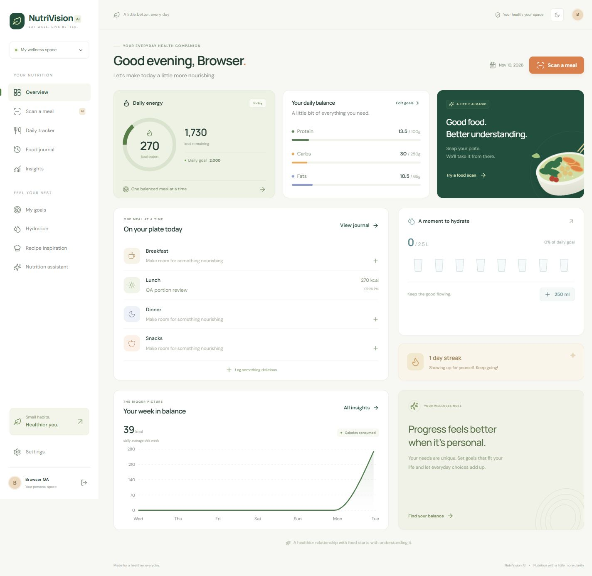

# NutriVision AI

A responsive food recognition and nutrition tracker built with **React JavaScript/JSX + Vite**, **Django REST Framework**, an independent **FastAPI AI service**, and a **Flask integration service**. Django owns the PostgreSQL database and JWT authentication. There is no competing Supabase Auth implementation.

This checkout contains working application code, database migrations, all requested public/user/admin routes, automated tests, Dockerfiles, Docker Compose, and deployment configuration. AI calls use a real provider; unavailable credentials produce a clear setup error, never sample predictions. No user meals, fabricated food catalog, or dashboard statistics are seeded.

## Start here on Windows

Requirements: Python 3.12+, Node.js 22+, npm. PostgreSQL is the default database. Docker is optional.

From this project's root:

```powershell
# For a fresh checkout without PostgreSQL installed:
python infrastructure/configure_local.py --sqlite
# Omit --sqlite to use PostgreSQL. This command refuses to overwrite an existing .env.

# Edit .env and add OPENAI_API_KEY and USDA_API_KEY for full AI/composition features.
python infrastructure/dev.py --setup
```

Open [the local app](http://127.0.0.1:5173). `Ctrl+C` stops the launcher's processes. The launcher creates independent virtual environments, installs dependencies and migrates the database. On subsequent runs, use `python infrastructure/dev.py`.

**This workspace already has a private `.env` with generated local secrets and `USE_SQLITE=true`. Do not overwrite it or commit it.** Add provider keys there. No default account/password is installed; sign up through the UI. Synthetic QA accounts are removed after testing.

For Docker/PostgreSQL:

```powershell
python infrastructure/configure_local.py
docker compose up --build
docker compose exec django python manage.py createsuperuser
```

If `.env` already exists, the first command intentionally exits; use that file. Docker Compose always uses its PostgreSQL service regardless of the local SQLite flag. Visit port 5173. The AI and integration services have no host-published ports in Compose. Django's loopback-only port 8000 is available for local development.

## Implemented behavior

| Area | Working functionality |
| --- | --- |
| Authentication | Signup/login/logout, protected routes, memory-only JWT access, HttpOnly rotating refresh cookie, CSRF-protected cookie endpoints, session revocation, email verification and reset links, configured Google/Apple identity-token sign-in |
| Food entry | Image upload and preview, camera capture, real multi-food AI pipeline, manual entry, searchable sourced catalog, real USDA composition enrichment, barcode lookup, supported-browser speech input |
| Review | Editable food names, additions/removals, gram portions, proportional nutrient recalculation, manual nutrient corrections, source/estimate labels, nullable unknown secondary nutrients |
| Tracking | Persistent meals and history, breakfast/lunch/dinner/snack, search/date/type filtering, edit/delete, daily calories/macros, hydration, editable goals, streaks and earned badges |
| Insights | Database-backed daily/7-day/30-day summaries, charts, goal progress, weight history, CSV/PDF reports |
| Personal | Profile, allergies/preferences, BMI, AI nutrition assistant, AI food/recipe recommendations, light/dark mode, English/Hindi settings/navigation, browser reminders while the app is open |
| Administration | Staff-only React dashboard, user access management, sourced food CRUD, AI usage/performance logs, subscription record management, Django Admin |
| Architecture | Secure Django proxies, owner isolation, upload limits/content validation, throttling, Channels user-scoped updates, shared Redis support, PostgreSQL/Supabase configuration, private S3-compatible storage |

English/Hindi translation currently covers settings, navigation and reminders; other screens use English. Barcode photo reading uses the browser BarcodeDetector where available, with typed barcode digits available everywhere. Voice entry uses supported browser speech recognition with a typed fallback. Camera/microphone need browser consent and HTTPS or localhost.

Core account → scan → review → portion correction → save → daily summary → history → analytics is connected in code. **A genuine image inference still requires your OpenAI credentials and was not tested live here.** Manual entry, database updates, reports, privacy boundaries and live barcode lookup were verified end to end. USDA lookup was also verified against the live service.

Payments, wearable synchronization, background push, community/family features and consultation booking are extension boundaries. Generic Flask webhooks validate and durably acknowledge receipts; they do not claim to process charges or import wearable data. See [architecture and extension design](docs/ARCHITECTURE.md).

## Project structure

```text
nutrivision-ai/
├── frontend/
│   ├── public/                       # icon, install manifest
│   ├── src/
│   │   ├── components/               # shadcn-style Radix primitives, meal editor
│   │   ├── pages/                    # public, dashboard, scan, history, features/admin
│   │   ├── layouts/                  # responsive sidebar + mobile navigation
│   │   ├── hooks/                    # queries, user-scoped realtime
│   │   ├── contexts/                 # auth, scan state, reminders
│   │   ├── services/                 # Axios client and protected exports
│   │   └── utils/                    # nutrition arithmetic, local dates, classes
│   ├── package.json / package-lock.json
│   └── vite.config.js / jsconfig.json / components.json
├── backend/
│   ├── django_api/                   # accounts, nutrition, meals, analytics,
│   │                                 # goals, notifications, subscriptions, config
│   ├── fastapi_ai/app/                # schemas, image utilities, real model + USDA
│   └── flask_integrations/app/        # barcode adapter + signed webhook receipts
├── infrastructure/                   # local setup/launcher and real HTTP smoke test
├── docs/                             # architecture, testing, deployment
├── .github/workflows/ci.yml
├── .env.example / .gitignore
└── docker-compose.yml
```

Frontend application/configuration source uses `.jsx` and `.js`, with no `.ts`/`.tsx` or TypeScript configuration. Packages may ship their own type declarations inside ignored `node_modules`.

## Run services separately

Run each service in its own terminal. Python services automatically load the project's `.env`; process environment variables take precedence. Use separate virtual environments as shown, or run the launcher above.

```powershell
# Django, from backend/django_api
python -m venv .venv
.\.venv\Scripts\python.exe -m pip install -r requirements.txt
.\.venv\Scripts\python.exe manage.py migrate
.\.venv\Scripts\python.exe manage.py createsuperuser
.\.venv\Scripts\python.exe manage.py runserver 127.0.0.1:8000

# FastAPI, from backend/fastapi_ai
python -m venv .venv
.\.venv\Scripts\python.exe -m pip install -r requirements.txt
.\.venv\Scripts\python.exe -m uvicorn app.main:app --host 127.0.0.1 --port 8001

# Flask, from backend/flask_integrations
python -m venv .venv
.\.venv\Scripts\python.exe -m pip install -r requirements.txt
.\.venv\Scripts\python.exe -m waitress --host=127.0.0.1 --port=8002 --call app:create_app

# React, from frontend
npm ci
npm run dev
```

Local URLs: frontend `http://127.0.0.1:5173`, Django `http://127.0.0.1:8000/api`, Django Admin `http://127.0.0.1:8000/admin/`. Vite proxies REST/WebSocket requests to Django. Always use the same hostname for login and refresh cookies.

## PostgreSQL and environment configuration

For provider signup steps and every field explained, see the [step-by-step .env setup guide](docs/ENV_SETUP.md).

Supabase supplies hosted PostgreSQL; copy the exact database connection string from your project's Connect panel. Example shape:

```dotenv
DATABASE_URL=postgresql://<username>:<url-encoded-password>@<host>:5432/postgres?sslmode=require
USE_SQLITE=false
```

Then run Django migrations. No Supabase browser key is needed. Use a session pooler if the hosting network requires IPv4. Follow the [Supabase connection documentation](https://supabase.com/docs/guides/database/connecting-to-postgres).

| Variables | Purpose |
| --- | --- |
| `DJANGO_SECRET_KEY`, `INTERNAL_SERVICE_TOKEN`, `WEBHOOK_SIGNING_SECRET` | Separate random server secrets; the internal token must match across the Python services |
| `DATABASE_URL`, `USE_SQLITE` | Primary PostgreSQL connection or explicit local SQLite option |
| `DJANGO_DEBUG`, `DJANGO_ALLOWED_HOSTS`, `FRONTEND_URL`, `CORS_ALLOWED_ORIGINS`, `CSRF_TRUSTED_ORIGINS`, `SECURE_SSL_REDIRECT` | Development/production origin and HTTPS settings |
| `AI_SERVICE_URL`, `INTEGRATIONS_SERVICE_URL`, `REDIS_URL` | Internal routing and shared realtime/cache infrastructure |
| `OPENAI_API_KEY`, `OPENAI_MODEL`, `USDA_API_KEY` | Real server-side vision/language provider and food composition data |
| `EMAIL_*`, `DEFAULT_FROM_EMAIL`, `REQUIRE_EMAIL_VERIFICATION` | Email delivery and verification policy; console email is local-only |
| `GOOGLE_CLIENT_ID`, `APPLE_CLIENT_ID` | Optional backend-verified OAuth identity audiences |
| `AWS_STORAGE_BUCKET_NAME`, `AWS_ACCESS_KEY_ID`, `AWS_SECRET_ACCESS_KEY`, `AWS_S3_ENDPOINT_URL`, `AWS_S3_REGION_NAME` | Optional private S3-compatible photo storage |
| `WEBHOOK_DATABASE_PATH`, `OPENFOODFACTS_USER_AGENT` | Integration receipt storage and barcode service attribution/contact |

Frontend public variables are listed in `frontend/.env.example`: `VITE_API_URL`, `VITE_WS_URL` and configured public OAuth client IDs/redirect URI. **Never prefix provider keys, database URLs or service secrets with `VITE_`.**

## AI configuration

Set `OPENAI_API_KEY` and `OPENAI_MODEL` in root `.env` and restart FastAPI. The default configurable `gpt-4o-mini` integration uses OpenAI's Responses API with real image input, structured JSON output and Pydantic validation. A different configured model must support image input and Structured Outputs. Reference: [OpenAI vision](https://developers.openai.com/api/docs/guides/images-vision), [Structured Outputs](https://developers.openai.com/api/docs/guides/structured-outputs).

Set `USDA_API_KEY` from FoodData Central for composition enrichment. Matching is approximate; mixed dishes/preparation can differ. The UI keeps source labels and portion corrections visible. A food recognition confidence value appears only when supplied by the model pipeline; no arbitrary confidence is invented. Unknown secondary nutrients remain unknown instead of becoming measured zero. Reference: [USDA API guide](https://fdc.nal.usda.gov/api-guide/).

No AI request automatically saves a meal. Confirmed meals are written only through Django. Uploaded image bytes are decoded, bounded to 8 MiB/20 megapixels and re-encoded without EXIF before inference. OpenAI requests use `store:false`.

## Validation and deployment

Verified on November 10, 2026: **64 automated tests passed** (Django 25, FastAPI 19, Flask 11, React 9), production frontend build passed, Django system/migration checks passed, and the real HTTP smoke workflow passed. Browser QA covered login/session restoration, manual food logging, portion edits, history edits, mobile layout and Hindi/dark settings. Live USDA/Open Food Facts calls passed. Production npm dependencies reported zero known vulnerabilities at verification time.



Live AI inference, real OAuth, SMTP delivery, PostgreSQL and cloud storage require supplied credentials/infrastructure and were not claimed tested. Docker is not installed in this environment, so Compose was prepared but not executed.

See [test commands and limits](docs/TESTING.md), [full Django API contract](backend/django_api/API.md), and [deployment instructions for Vercel + Python hosting + Supabase](docs/DEPLOYMENT.md). A configurable Vercel rewrite example is included; no service has been published to an external host.
