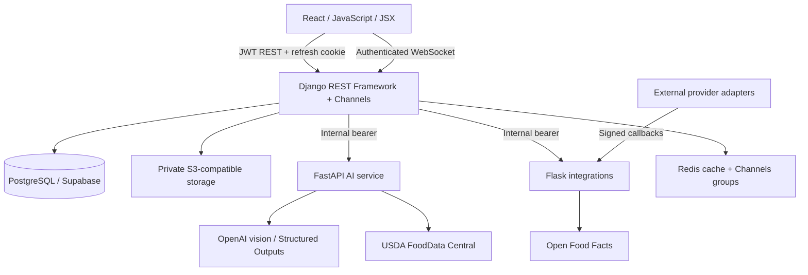

# Architecture and extension boundaries

The browser communicates with Django only. Provider keys and the internal service token never enter the Vite environment. Django owns authentication, nutrition records, authorization, calculations, reports, subscriptions, and staff administration. FastAPI is stateless image/language inference; Flask is an independent adapter boundary.

## Core workflow

1. Django authenticates and creates an HttpOnly rotating refresh cookie; access credentials stay in memory.
2. React sends a validated food image through the Django AI proxy. FastAPI decodes and re-encodes it to strip EXIF, calls the configured vision model, validates structured output, and optionally enriches composition with USDA records.
3. The UI labels estimates and presents all foods for correction. Nutrients on a meal item are **totals for its portion**. Changing grams scales these totals proportionally. Unknown fiber, sugar, and sodium remain null; summaries expose `unknown_nutrients` so known subtotals are distinguishable from complete totals.
4. The user confirms; Django transactionally saves meal items, associates the owner-bound recognition record, and emits a user-scoped change event after commit. Clients refetch totals and trends from the database.
5. Private reports and meal images use authenticated owner-filtered endpoints. AI input photos are not automatically stored as public objects.

## Data model

`accounts`: custom User, UserProfile, DietPreference, Allergy, WeightHistory.

`nutrition`: FoodCategory, Food, NutritionInformation (a sourced composition catalog with a gram basis).

`meals`: Meal, MealItem, FoodRecognitionResult, AIAnalysisLog.

`goals`, `notifications`, `subscriptions`: NutritionGoal, WaterIntake, Notification, UserAchievement, Subscription.

Primary records use Django migrations, ownership filters, constraints and indexes. PostgreSQL is the deployment database. The explicit SQLite option is for local work/tests. Redis is required when multiple workers must share throttles and realtime groups.

## External dependencies

An OpenAI key and compatible image/Structured Outputs model are required for real inference. Missing credentials cause a clear 503; no hardcoded predictions are substituted. USDA enrichment requires a FoodData Central key; when absent, AI nutrition remains explicitly estimated. Barcode lookup calls Open Food Facts without a paid API key and includes source attribution.

Google and Apple sign-in are conditional on configured client IDs and authorized domains. SMTP is required to deliver verification/reset emails. The development console backend writes emails only to the local terminal.

Browser meal reminders are real notifications **while the app is open**, using persisted time and time zone. Background Web Push and scheduled email delivery are separate adapters, not claimed as shipped functionality.

## Designed extension seams

The following requested future modules have architectural boundaries, not placeholder navigation or working-service claims:

- **Community challenges:** a Django `community` app with Challenge and UserChallenge tables; opt-in public aggregates, never private meal sharing by default.
- **Family tracking:** Family and FamilyMembership with explicit owner/member roles and consent. Add scope permissions rather than relaxing existing owner filters.
- **Grocery lists:** a `planning` app with ShoppingList and ShoppingItem; recipes may supply draft ingredients but cannot create lists without a user action.
- **Workouts:** an independent activity adapter. Keep energy expenditure separate from measured food intake and annotate provider provenance.
- **Dietitian booking:** provider-backed availability/reservations, verified professional profiles, explicit consent, and separate sensitive consultation records.
- **Wearables/payments:** provider-specific signature validation and event adapters in Flask, then authenticated idempotent commands to Django. Current HMAC webhook endpoints only durably acknowledge verified receipts (`processed: false`). They do not pretend to charge cards or import wearable records.
- **Background notifications:** worker scheduler + delivery provider, with consent/subscription lifecycle in Django and webhook delivery events via Flask.

For horizontally scaled Flask instances, migrate the durable local webhook replay ledger to shared storage/queue with a unique `(provider,event_id)` constraint. The ledger contains integration events only; application nutrition records remain in PostgreSQL.
